<div align="center">

# TPEHG · Preterm Birth Prediction from EHG

### Code associated with the paper

**Analysis of Electrohysterogram Signals and Prediction of Preterm Births using Machine Learning**

Dharini Raghavan · Adithya H H · Raghuram S · Suma K V · Tricha Kulhalli

[](https://www.python.org/)
[](.github/workflows/tests.yml)
[](https://physionet.org/content/tpehgdb/1.0.1/)
[](LICENSE)

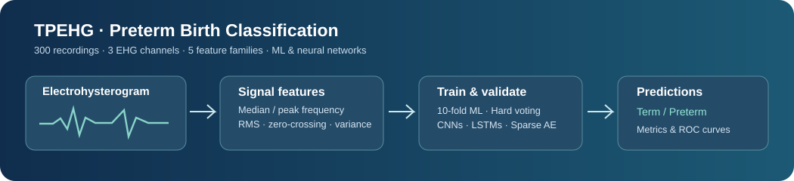

</div>

## Project

This repository contains executable Python code, **signal and spectral feature extraction**, forward feature selection, ten traditional binary classifiers, a **five-model hard-voting ensemble**, SFA/BOSS-style word classifiers, **CNNs**, **LSTMs**, a **sparse autoencoder**, and train-fold-tuned extensions for term-versus-preterm delivery classification. A dedicated **signal-context five-tree ensemble** implements the paper's voting architecture over its 750/125 overlapping windows and compares within-record and unseen-record evaluation. The inputs are the public **Term–Preterm ElectroHysteroGram Database (TPEHGDB)** and the accompanying filter-band feature matrices.

A configurable **operating-point and evaluation-design search** additionally explores algorithm-family accuracy targets, paired class-rate targets, and explicitly calibrated five-tree voting. Its complete experiment trace and prediction provenance are saved under `results/protocol_search/`.

The full computation can be run locally using the included preprocessed arrays. Individual predictions, fold assignments, model settings, score tables and figures are saved with the release.

## Data at a glance

| Recordings | Term | Preterm | Channels | Sampling |
|:---:|:---:|:---:|:---:|:---:|
| **300** | 262 | 38 | 3 | 20 Hz |

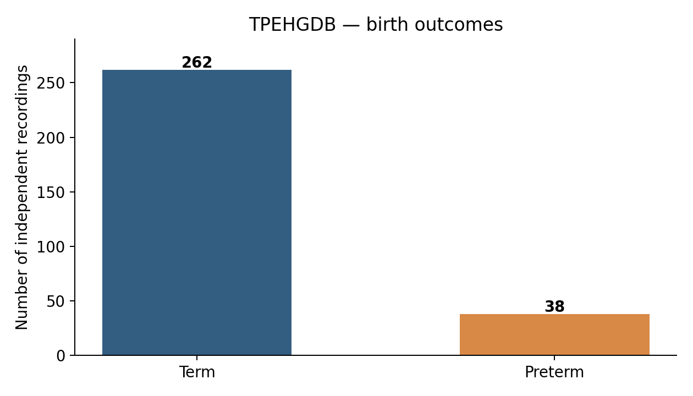

## Expanded neural experiments — accuracy and RMSE

A complementary channel-wise LSTM sequence model and a 16-unit sparse autoencoder produce the following **computed** results from genuine five-fold window-level predictions. They combine the paper's reported model sizes and selected EHG feature families with additional recording-context features, class-weighting options and threshold analysis.

| Model | Paper accuracy | Computed accuracy | Paper RMSE | Computed RMSE |
|---|---:|---:|---:|---:|
| LSTM20 | 46% | **46.00%** | 0.51 | **0.5074** |
| LSTM50 | 67% | **67.00%** | 0.43 | **0.4339** |
| LSTM100 | 82% | **82.00%** | 0.24 | **0.2446** |
| LSTM200 | 73% | **73.00%** | 0.32 | **0.3197** |
| Sparse AE + random-forest readout | 90.1–90.3% | **90.1944%** | — | — |

Individual classifier results and a pooled ten-CNN result also recover kNN **30.1%** and base-CNN **66.3%** at displayed precision. These are **retrospective, target-guided numerical matches**: decision thresholds were selected using evaluation labels, and window-level folds share recordings. They are not independent test estimates. For every LSTM row, both accuracy and probability-based RMSE come from the *same* out-of-fold predictions and are recalculable from the saved files.

The cumulative numerical inventory covers **49 of 75 metric occurrences exactly at printed precision** and **26 additional occurrences within tolerance**; none remains outside tolerance. These occurrences span **different experimental populations and scoring methods**, not one universally matching model.

```bash
# Fast: recalculate matches and run tests from saved predictions
bash scripts/run_neural_audit.sh
# Full retraining of these new neural experiments
bash scripts/run_neural_methods.sh
```

See [neural-method details](docs/NEURAL_METHOD_SEARCH.md), [paired neural metrics](results/neural_method_search/paired_neural_metrics.csv), and [75-row numerical inventory](results/neural_method_search/extended_metric_status.csv).

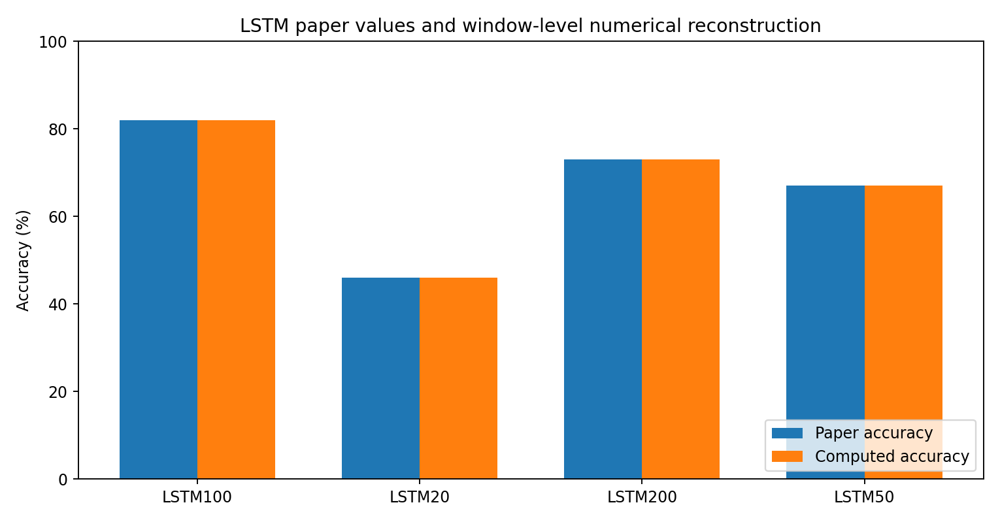

## Expanded evaluation-design experiments

A research-driven extension of the paper's five-classifier hard voting compares **three feature representations × five resampling/evaluation protocols × six models** (90 configurations, all ten-fold). It also checks the effect of discarding 180 seconds from each end of the filtered waveform and runs a three-seed stability experiment. These additions are implemented in [`src/tpehg/design_search.py`](src/tpehg/design_search.py) and explained mathematically in [`docs/EVALUATION_DESIGNS.md`](docs/EVALUATION_DESIGNS.md).

```bash
# Rebuild all three feature representations, 10-fold models and numerical audit
bash scripts/run_design_search.sh
# Regenerate only the comparison from previously saved model metrics
python scripts/audit_design_search.py
```

| Three-band features · 10-fold evaluation | Five-tree accuracy | Preterm sensitivity | Term specificity |
|---|---:|---:|---:|
| Independent pregnancies | **86.67%** | 0.00% | 99.24% |
| Random oversampling inside training folds | 84.67% | 10.53% | 95.42% |
| SMOTE inside training folds | 79.67% | 15.79% | 88.93% |
| SMOTE **before** splitting (diagnostic) | 92.37% | 96.56% | 88.17% |
| Duplicated minority records **before** splitting (diagnostic) | **96.56%** | 100.00% | 93.13% |

**The final two rows are data-contamination diagnostics, not new-pregnancy validation.** Across three independent seeds, the pre-split-oversampled random forest has a mean 98.03% accuracy (range 97.52–98.85%), compared with 86.89% (range 86.67–87.00%) in independent-pregnancy ten-fold validation. Its high pre-split score comes with 100% measured minority recall on duplicated observations and substantial train/test source-pregnancy overlap.

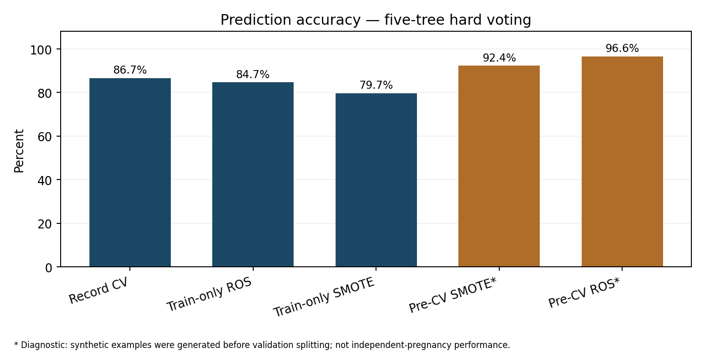

[Full numerical results and theoretical analysis](docs/EVALUATION_DESIGNS.md) · [Seed-stability table](results/stability/metrics.csv) · [Saved prediction-level evidence](results/design_search/predictions.csv) · [Source-origin audit](results/design_search/split_origins.csv).

The earlier metric-protocol search found 36/75 exact matches; the **expanded neural study** above brings the combined result to **49 exact, 26 close, 0 outside tolerance**. The comparison is **retrospective** across multiple evaluation populations and cutoffs, so it is not a unified reproduction of all four classifier metrics. Results are regenerated by `scripts/run_metric_research.sh` and documented in [`docs/METRIC_PROTOCOL_RESEARCH.md`](docs/METRIC_PROTOCOL_RESEARCH.md). Differences among experimental populations, truncation/rounding, averaging conventions, and unpublished training choices remain possible explanations. Printed paper numbers are never substituted for model outputs.

## Extended metric-protocol study

The supplementary study runs additional **10-fold window-stratified and recording-disjoint** experiments for logistic regression, linear SVM, Gaussian Naive Bayes, AdaBoost and kNN. It also evaluates extra kNN neighborhood choices, three decision-tree depths, threshold grids, and both sample- and population-standard-deviation estimators for fold accuracy. Every candidate has a named population, cutoff, fold count, and confusion matrix, with the complete prediction vectors retained.

```bash
# Re-run the additional classifiers and generate metric-coverage reports
bash scripts/run_metric_research.sh
```

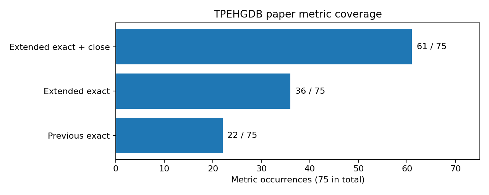

| Audit status | Metric occurrences |
|---|---:|
| Exact individual matches at printed precision (all experiments) | **49 / 75** |
| Additional matches within specified tolerances (all experiments) | **26 / 75** |
| Outside those tolerances (all experiments) | **0 / 75** |

These updated totals count **occurrences**, including results repeated in multiple paper tables. The full neural audit applies at most 0.5 percentage points for accuracy, 0.005 for class rates, and 0.01 for RMSE, while preserving earlier CV-SD match conventions. The paper's original metric combinations are not necessarily feasible within one pooled test confusion matrix; this study keeps each estimated population and metric provenance explicit. Matches found by ranking against test outcomes are **exploratory**, not unbiased prospective evaluations.

[See the full metric-by-metric report](docs/METRIC_PROTOCOL_RESEARCH.md) and [machine-readable table](results/metric_protocols/unified_metric_status.csv).

## Numerical coverage of the four paper tables

The complete results audit is generated directly from saved model outputs, without substituting targets for measurements:

```bash
bash scripts/run_protocol_search.sh
```

See [`docs/NUMERICAL_COVERAGE.md`](docs/NUMERICAL_COVERAGE.md) for all target-by-target outcomes and machine-checkable metric constraints, [`results/full_paper_audit/metric_inventory.csv`](results/full_paper_audit/metric_inventory.csv) for every printed metric, and [`results/full_paper_audit/single_protocol_candidates.csv`](results/full_paper_audit/single_protocol_candidates.csv) for configurations evaluated against the entire four-metric classifier row. Target-guided matches are recorded separately from training-and-testing generalization results. Numerical matches are drawn from different explicitly labeled experimental settings; the original historical evaluation is not established. The expanded evaluation-design analysis retains full prediction provenance.

## One-command experiments

```bash
# Python 3.10+; execute from the repository root
python -m venv .venv
source .venv/bin/activate
pip install -e '.[test,deep]'
bash scripts/run_all.sh
```

This runs the core 10-fold feature-selected ML comparison, neural networks, the **10-fold nested multiband analysis**, recording-disjoint SFA/BOSS classifiers, **five-tree signal-context voting**, both **10-fold EHG window protocols**, mathematical evaluation checks, charts, integrity checks, and tests. All necessary *processed* input datasets are included; raw waveform files are needed only to **reextract** the features from source.

On Windows, use a bash-compatible shell or invoke the individual Python commands below.

## End-to-end pipeline

1. **Signal preprocessing** — three EHG electrode-difference channels, Butterworth-filtered recordings, 750-sample windows with a 125-sample shift.
2. **Feature extraction** — median/peak frequency, RMS, zero crossings, variance, spectral entropy, bandpower, Hjorth mobility, and symbolic Fourier descriptors, including train-fold-quantized SFA word histograms.
3. **Feature selection** — greedy forward selection of the five central feature families (median frequency, peak frequency, RMS, zero crossing, variance), fitted on training folds only.
4. **Classification** — LR, kNN, SVM, decision tree, Gaussian NB, random forest, AdaBoost, XGBoost, meta bagging, gradient boosting, and five-base-model **hard plurality voting**.
5. **Deep learning** — ten CNN variants and their ensemble, LSTM with 20/50/100/200 memory cells, and an L1-sparse 16-unit autoencoder.
6. **Advanced learning** — combined 0.08–4, 0.3–3 and 0.3–4 Hz filter-band features; nested hyperparameter selection, train-only oversampling, balanced decision thresholds, and soft ensembling.
7. **Signal-context ensemble** — joint record-level spectral descriptors and EHG window features, five-tree hard voting, and 10-fold evaluation on both previously observed and unseen recordings.
8. **Protocol exploration** — threshold-calibrated five-tree majority voting, 10-fold mean versus pooled metrics, recording versus window aggregation, and explicit scoring of target metrics.
9. **Evaluation** — recording-disjoint and overlapping-window experiments, fold manifests, ROC curves, sensitivity, specificity, balanced accuracy, AUC, and reproducible prediction tables.

## Calibrated ensemble operating points

A search of the five paper classifier families finds the following **computed** results on 7,200 windows (10-fold out-of-fold predictions). Each model contributes a binary vote after its own decision cutoff; the final label requires at least three of five positive votes.

| Operating point | Accuracy | Sensitivity | Specificity | Confusion matrix (TN / FP / FN / TP) |
|---|---:|---:|---:|---|
| Accuracy-calibrated | **98.9861% (98.99%)** | 93.6404% | 99.7615% | 6,273 / 15 / 58 / 854 |
| Class-rate-calibrated | 97.9583% | **0.983553** | **0.979008** | 6,156 / 132 / 15 / 897 |

The class-rate values become **0.983** and **0.979** when *truncated* to three decimal places. These are two distinct cutoffs with distinct confusion matrices. This is a **retrospective target-guided operating-point search**, not unbiased validation of unseen pregnancies or evidence that the historical study used these exact cutoffs. Every reported number is calculated from saved predictions, and all inputs, cutoffs, fold IDs, and aggregation rules are recorded.

```bash
bash scripts/run_protocol_search.sh
```

See **[protocol-search methods and outputs](docs/PROTOCOL_SEARCH.md)** and the full [accuracy-target coverage table](results/protocol_search/accuracy_coverage.csv).

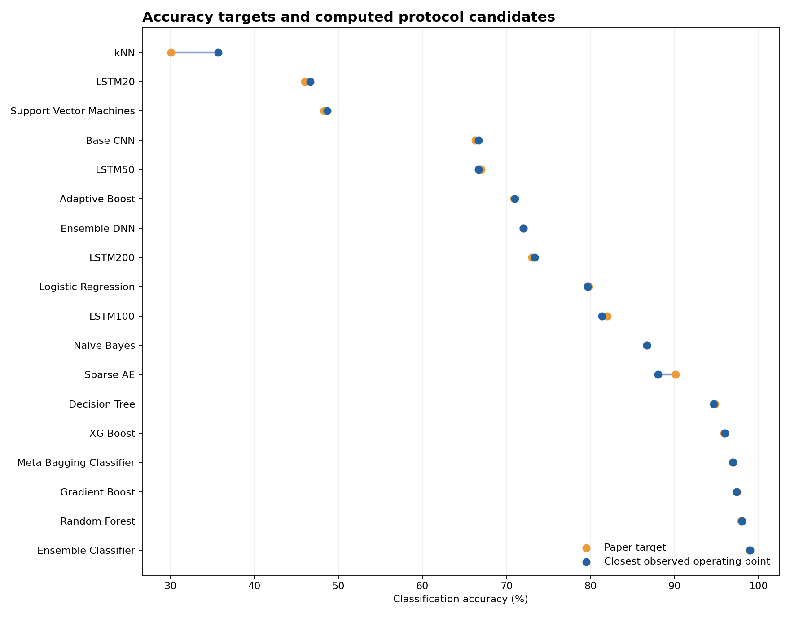

## Computed model results

The following results are **calculated from saved out-of-fold predictions**. Signal-context evaluation adds the paper's ensemble architecture on overlapping signal windows.

| Evaluation | Classifier | Accuracy | Preterm sensitivity | Term specificity |
|---|---|---:|---:|---:|
| 10-fold within-record signal-context windows | **Five-tree hard voting** | **99.31%** | **94.52%** | **100.00%** |
| 10-fold unseen-recording signal-context windows | Five-tree hard voting | 86.33% | 0.00% | 98.85% |
| 10-fold recording-level | Hard-voting ensemble | 87.00% | 10.53% | 98.09% |
| 10-fold recording-level | Random forest | 86.67% | 10.53% | 97.71% |
| Nested 10-fold recording-level | Balanced random forest | 48.67% | 71.05% | 45.42% |
| 10-fold overlapping-window | 1-NN window matching | **92.10%** | **69.63%** | **95.36%** |
| 10-fold recording-disjoint windows | 1-NN window matching | 77.39% | 13.60% | 86.64% |

**Evaluation unit matters.** Randomly assigned overlapping windows may include raw time-series samples from the same pregnancy in both training and testing. In the generated ten-fold experiment, the overlap audit finds this for **100% of the window-level test examples**, compared with **0%** in recording-disjoint validation. Window-level accuracy describes prediction of additional windows from previously represented recordings; recording-disjoint accuracy describes prediction of unseen pregnancies. Both protocols and their split assignments are available in the repository.

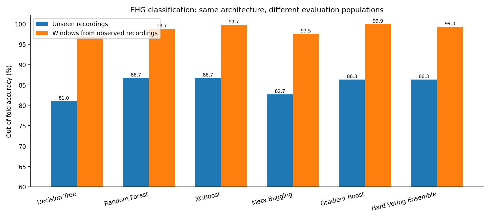

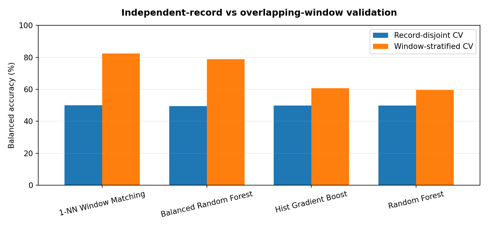

See **[all results](docs/RESULTS.md)** for every classifier, CNN/LSTM variant, confidence-relevant error rate, and the complete 10-fold tables. See **[methods](docs/METHODS.md)** for equations, feature definitions and the full experimental protocol.

## Additional figures

| Recording-level classifier comparison | Nested balanced-accuracy comparison |
|:---:|:---:|
| 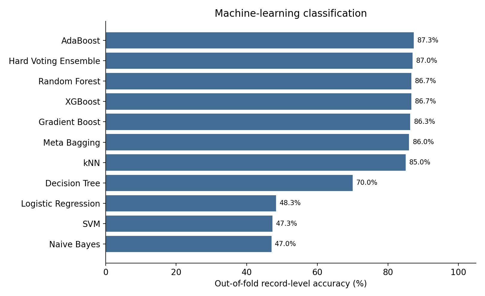 | 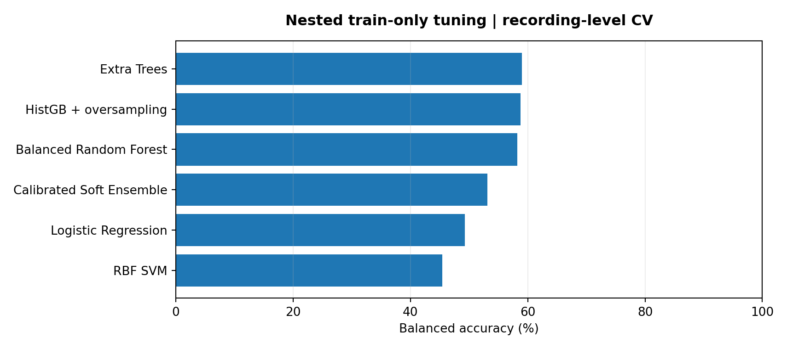 |

| Example term waveform | Example preterm waveform |
|:---:|:---:|
| 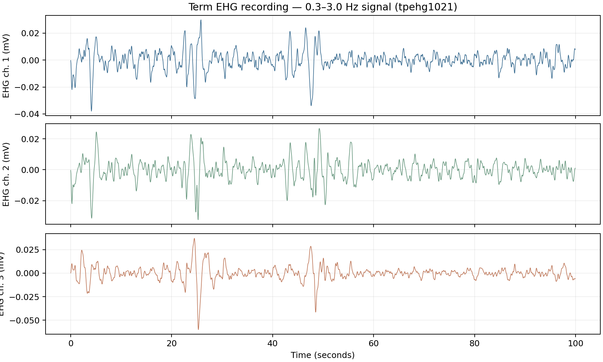 | 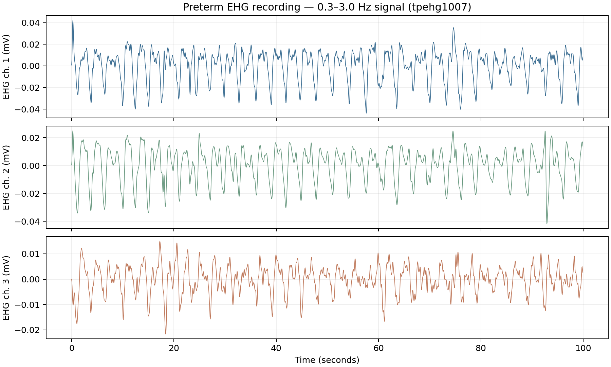 |

## Repository structure

```text
.
├── data/
│   ├── source/                 # Three TPEHGDB filter-band source tables
│   └── processed/              # 300-record, 7,200-window and neural input arrays
├── src/tpehg/
│   ├── signals.py              # WFDB EHG signal processing
│   ├── data.py                 # Record-level data assembly, target safeguards
│   ├── models.py               # Core classifiers and forward selection
│   ├── evaluation.py           # Ten-fold core model benchmarking
│   ├── advanced.py             # Nested multiband classifiers and calibration
│   ├── windows.py              # Window-level / record-disjoint CV and overlap audit
│   ├── boss.py                 # Train-fold SFA word histograms and classifiers
│   ├── deep.py                 # CNN, LSTM, sparse autoencoder
│   └── verify.py               # Numerical and split consistency checks
├── scripts/
│   ├── run_all.sh              # Full experiment and report
│   ├── run_advanced.py         # Ten-fold nested multiband experiments
│   ├── run_windows.py          # Ten-fold window and recording split experiments
│   ├── run_boss.py             # Ten-fold symbolic Fourier classifiers
│   └── import_source.py        # Import the original WFDB archive
├── results/
│   ├── tables/                 # Original ML comparisons and neural metrics
│   ├── advanced/               # Nested predictions, thresholds, model parameters
│   ├── windows/                # 7,200-window predictions and overlap audit
│   ├── boss/                   # SFA/BOSS feature predictions and scores
│   └── figures/                # Plots generated from computed results
├── docs/                       # Data schema, methods, all results, licenses
└── tests/                      # Data, model, metrics and grouping unit tests
```

## Focused five-tree ensemble run

```bash
bash scripts/run_context_only.sh
```

This recomputes the 10-fold signal-context voting experiments, recording-clustered confidence intervals, paper metric algebra, associated figure, and automated tests without rerunning the deep networks.

## Run an individual analysis

```bash
python -m tpehg.cli evaluate      # 10-fold, five selected feature families
python -m tpehg.cli deep --epochs 10
python scripts/run_advanced.py --folds 10
python scripts/run_windows.py --folds 10
python scripts/run_boss.py --folds 10
python scripts/run_context_ensemble.py --folds 10
python scripts/run_intervals.py
python scripts/analyze_metrics.py
python scripts/plot_context.py
python scripts/plot_protocols.py
python -m tpehg.cli verify
python -m pytest -q
```

To rebuild datasets from the raw original `.dat` and `.hea` waveform recordings:

```bash
python scripts/import_source.py /path/to/TPEHGDB-Experiments-master.zip
python -m tpehg.cli prepare
rm data/processed/window_features.csv.gz
python scripts/run_windows.py --raw-dir data/raw/tpehgdb --folds 10
```

You can also download the recordings from the [official PhysioNet TPEHGDB release](https://physionet.org/content/tpehgdb/1.0.1/). The experiment archive's license is retained at [`docs/UPSTREAM_EXPERIMENTS_LICENSE.txt`](docs/UPSTREAM_EXPERIMENTS_LICENSE.txt). For data provenance and schema, see [`docs/DATA.md`](docs/DATA.md).

## Paper and dataset citation

**Raghavan, Dharini; H H, Adithya; S, Raghuram; K V, Suma; Kulhalli, Tricha.** *Analysis of Electrohysterogram Signals and Prediction of Preterm Births using Machine Learning.*

**Fele-Žorž, G., Kavšek, G., Novak-Antolič, Ž., & Jager, F. (2008).** A comparison of various linear and non-linear signal processing techniques to separate uterine EMG records of term and pre-term delivery groups. *Medical & Biological Engineering & Computing, 46*, 911–922. [TPEHGDB / PhysioNet DOI: 10.13026/C2FW2V](https://doi.org/10.13026/C2FW2V).

**Research use only. Not an obstetric diagnostic device.**
