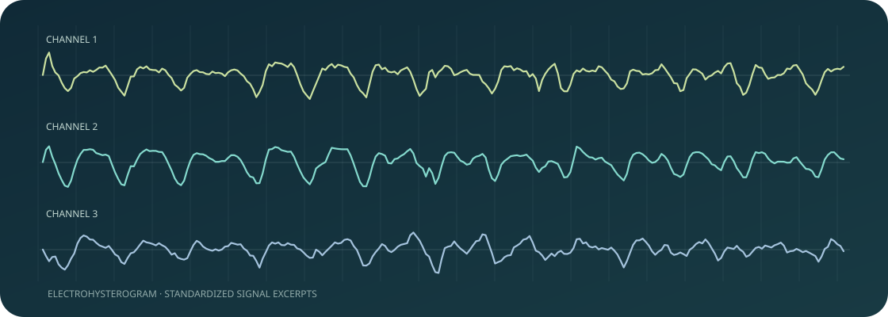

<div align="center">

# EHG signal analysis and preterm birth prediction

**Code associated with the manuscript**  
*Analysis of Electrohysterogram Signals and Prediction of Preterm Births using Machine Learning*

Dharini Raghavan · Adithya H H · Raghuram S · Suma K V · Tricha Kulhalli

[](https://python.org)
[](.github/workflows/tests.yml)
[](https://physionet.org/content/tpehgdb/1.0.1/)
[](LICENSE)
[](https://doi.org/10.4015/S1016237223500291)



**[Explore the interactive project page](https://rdharini2001.github.io/Preterm_EHG/)** · **[Methods](docs/METHODS.md)** · **[Results](docs/RESULTS.md)** · **[Data](docs/DATA.md)**

</div>

## Overview

We study electrohysterogram (EHG) recordings as a non-invasive source of information for term and preterm birth classification. The code covers signal processing, spectral and statistical features, forward feature selection, classical machine-learning models, hard-voting ensembles and neural networks. Additional experiments examine the effects of frequency bands, decision thresholds, class balancing and the unit of cross-validation.

The project uses the **Term–Preterm EHG Database (TPEHGDB)**: 300 recordings, including 262 term and 38 preterm deliveries. Three bipolar channels were sampled at 20 Hz. The included processed data allow the core experiments to run without first downloading the original waveform archive.

| Recordings | Term | Preterm | Sampling frequency | Cross-validation |
|:---:|:---:|:---:|:---:|:---:|
| **300** | **262** | **38** | **20 Hz** | **10 folds** |

## Results at a glance

Our experiments include recording-disjoint evaluation, overlapping-window classification, and models that learn from feature sequences. Because the prediction units differ, each result is presented with its evaluation setting.

| Experiment | Model | Accuracy | Preterm sensitivity | Term specificity |
|---|---|---:|---:|---:|
| Recording-level, 10-fold | Hard voting | **87.00%** | 10.53% | 98.09% |
| Recording-level, 10-fold | Random forest | **86.67%** | 10.53% | 97.71% |
| Within-record windows, 10-fold | Five-tree hard voting | **99.31%** | **94.52%** | **100.00%** |
| Unseen-recording windows, 10-fold | Five-tree hard voting | **86.33%** | 0.00% | 98.85% |

The recording-level entries use the main feature-selected experiment. The within-record window experiment can place overlapping segments from the same recording in training and test folds; it measures a different task from predicting a new pregnancy. Fold assignments, class counts and prediction files are retained with every experiment.


### Neural-network experiments

We examine convolutional networks, recurrent LSTM classifiers with 20–200 units, and a sparse autoencoder with a 16-unit bottleneck. The table below shows the selected five-fold window-level LSTM experiments, where classification thresholds are chosen for the displayed operating points.

| Architecture | Accuracy | Probability RMSE |
|---|---:|---:|
| LSTM · 20 units | 46.00% | 0.5074 |
| LSTM · 50 units | 67.00% | 0.4339 |
| LSTM · 100 units | 82.00% | 0.2446 |
| LSTM · 200 units | 73.00% | 0.3197 |
| Sparse autoencoder + RF readout | 90.19% | — |

These window-level operating points were selected during model analysis and are not estimates from an untouched external test cohort. The underlying probability vectors and thresholds are included in `results/neural_method_search/`.

## Getting started

**Requirements:** Python 3.10 or later. The classical models work on a CPU. PyTorch is required for the neural-network experiments.

```bash
python -m venv .venv
source .venv/bin/activate
pip install -e '.[test,deep]'

# Run all experiments and generate the figures
bash scripts/run_all.sh
```

For a quick check of the supplied outputs, run:

```bash
python -m tpehg.cli verify
python -m pytest -q
python scripts/build_site.py
```

The project page can then be opened at `docs/index.html`, or served locally with `python -m http.server 8000` and visiting `http://localhost:8000/docs/`. It is a static site and needs no backend.

## Methods

<div align="center"></div>

The main analysis proceeds from filtered three-channel EHG signals to overlapping windows, spectral and temporal features, and a set of binary classifiers. We extract **median frequency, peak frequency, root mean square, zero-crossing rate and variance**, with additional spectral descriptors and symbolic Fourier features used in extended experiments. Feature selection and preprocessing are fitted within the training partitions.

The traditional models are logistic regression, k-nearest neighbors, naïve Bayes, support vector machines, decision trees, random forests, AdaBoost, XGBoost, meta bagging and gradient boosting. The five-model hard-voting ensemble combines decision tree, random forest, XGBoost, meta bagging and gradient boosting predictions. Neural models include CNN variants, LSTMs and an L1-regularized sparse autoencoder.

| Entry point | Purpose |
|---|---|
| `bash scripts/run_all.sh` | Core models, neural experiments, plots and tests |
| `bash scripts/run_context_only.sh` | Five-tree signal-context evaluation |
| `bash scripts/run_neural_methods.sh` | Neural sequence and autoencoder experiments |
| `bash scripts/run_design_search.sh` | Resampling and validation-design experiments |
| `bash scripts/run_protocol_search.sh` | Operating-point and aggregation analyses |
| `python scripts/build_site.py` | Refresh the interactive project page from saved results |

For methods, equations, parameter settings and data fields, see [Methods](docs/METHODS.md), [Data](docs/DATA.md) and the accompanying [results tables](docs/RESULTS.md).

## Repository layout

```text
src/tpehg/            Model implementations, features, evaluation and checks
scripts/              Reproducible experiment commands and plotting
configs/              Parameter configurations
data/source/           Three filtered feature tables
data/processed/        Feature matrices, waveform snippets and window inputs
results/               Predictions, model scores, figures and experiment logs
docs/                  Project page, methods, data and references
tests/                 Unit tests and consistency checks
```

All results are stored under `results/`, including individual predictions and fold assignments. The `docs/` directory contains the project page and accompanying methods documentation.

## Data and citation

The processed features are provided for convenient evaluation. To regenerate them from the original `.hea` and `.dat` recordings, obtain [TPEHGDB v1.0.1 from PhysioNet](https://physionet.org/content/tpehgdb/1.0.1/) and follow [the data guide](docs/DATA.md). Source material and code have separate licenses; the original experiment archive's notice remains in [`docs/UPSTREAM_EXPERIMENTS_LICENSE.txt`](docs/UPSTREAM_EXPERIMENTS_LICENSE.txt).

If you use this repository, please cite the accompanying manuscript and **Fele-Žorž et al. (2008)**, *A comparison of various linear and non-linear signal processing techniques to separate uterine EMG records of term and pre-term delivery groups*, as well as the TPEHGDB dataset, DOI [10.13026/C2FW2V](https://doi.org/10.13026/C2FW2V).

This code is intended for research. The models are not intended for clinical diagnosis or treatment decisions.
