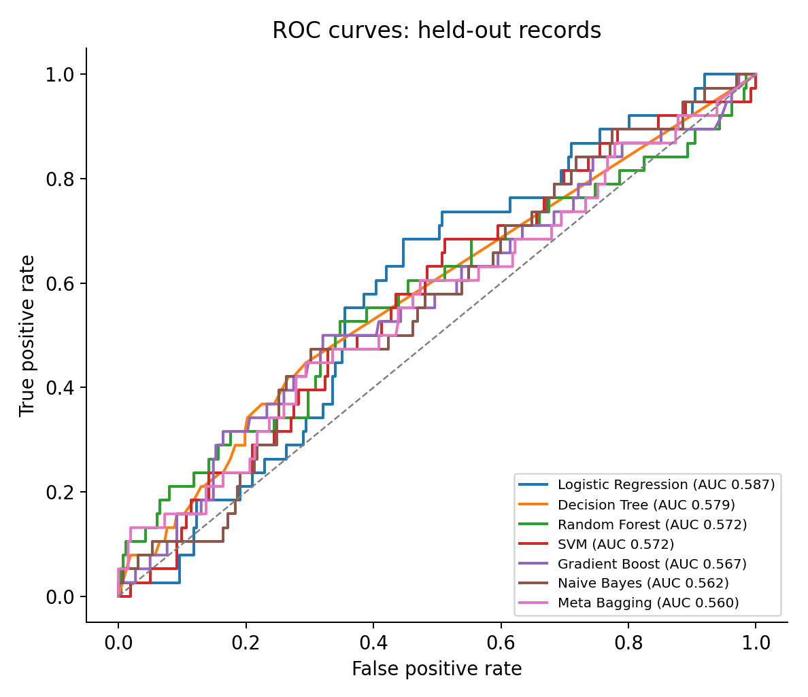
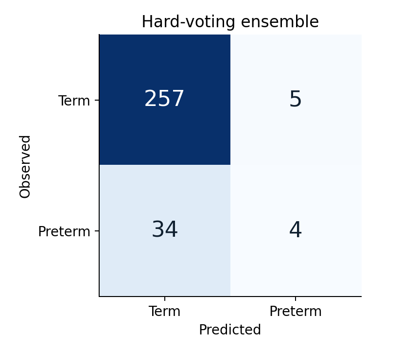
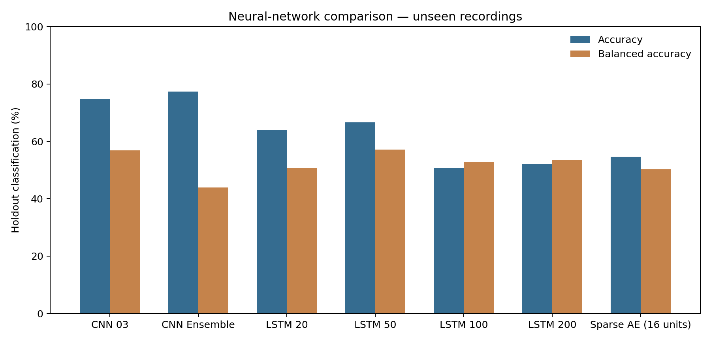

# Classification results

## TPEHGDB cohort

The study includes 300 EHG recordings: **262 term** and **38 preterm**.
A record is the unit of evaluation. No channels or temporal windows of a recording cross the training/test boundary.

## Feature-based classifiers

Ten-fold stratified cross-validation. Forward selection of the five main feature families runs independently inside each training fold. Model inputs comprise three channels for each selected feature family.

| Algorithm            |   Accuracy (%) |   Sensitivity |   Specificity | AUC   |   CV SD |
|:---------------------|---------------:|--------------:|--------------:|:------|--------:|
| AdaBoost             |          87.33 |         0     |         1     | 0.531 |   0.013 |
| Hard Voting Ensemble |          87    |         0.105 |         0.981 | —     |   0.031 |
| XGBoost              |          86.67 |         0     |         0.992 | 0.528 |   0.015 |
| Random Forest        |          86.67 |         0.105 |         0.977 | 0.572 |   0.047 |
| Gradient Boost       |          86.33 |         0.026 |         0.985 | 0.567 |   0.023 |
| Meta Bagging         |          86    |         0.132 |         0.966 | 0.560 |   0.036 |
| kNN                  |          85    |         0     |         0.973 | 0.469 |   0.031 |
| Decision Tree        |          70    |         0.395 |         0.744 | 0.579 |   0.102 |
| Logistic Regression  |          48.33 |         0.737 |         0.447 | 0.587 |   0.093 |
| SVM                  |          47.33 |         0.684 |         0.443 | 0.572 |   0.116 |
| Naive Bayes          |          47    |         0.632 |         0.447 | 0.562 |   0.214 |






## Extended signal descriptor models

The extended experiment adds spectral entropy and symbolic Fourier frequency descriptors to the five signal feature families.

| model                |   accuracy |   sensitivity |   specificity |
|:---------------------|-----------:|--------------:|--------------:|
| Random Forest        |      0.87  |         0     |         0.996 |
| XGBoost              |      0.867 |         0.026 |         0.989 |
| kNN                  |      0.867 |         0     |         0.992 |
| Gradient Boost       |      0.867 |         0     |         0.992 |
| Hard Voting Ensemble |      0.867 |         0     |         0.992 |
| AdaBoost             |      0.863 |         0.026 |         0.985 |

## Neural-network classifiers

Stratified 75/25 recording-level holdout. The input combines five EHG windows per recording, and the sparse autoencoder uses 16 bottleneck units.

| model                |   accuracy |   sensitivity |   specificity |   auc |
|:---------------------|-----------:|--------------:|--------------:|------:|
| CNN 01               |      0.813 |         0     |         0.924 | 0.589 |
| CNN 02               |      0.827 |         0     |         0.939 | 0.448 |
| CNN 03               |      0.747 |         0.333 |         0.803 | 0.648 |
| CNN 04               |      0.813 |         0.111 |         0.909 | 0.596 |
| CNN 05               |      0.76  |         0     |         0.864 | 0.532 |
| CNN 06               |      0.76  |         0.222 |         0.833 | 0.49  |
| CNN 07               |      0.693 |         0.111 |         0.773 | 0.534 |
| CNN 08               |      0.747 |         0     |         0.848 | 0.458 |
| CNN 09               |      0.747 |         0.222 |         0.818 | 0.5   |
| CNN 10               |      0.813 |         0     |         0.924 | 0.545 |
| CNN Ensemble         |      0.773 |         0     |         0.879 | 0.527 |
| LSTM 20              |      0.64  |         0.333 |         0.682 | 0.551 |
| LSTM 50              |      0.667 |         0.444 |         0.697 | 0.579 |
| LSTM 100             |      0.507 |         0.556 |         0.5   | 0.476 |
| LSTM 200             |      0.52  |         0.556 |         0.515 | 0.507 |
| Sparse AE (16 units) |      0.547 |         0.444 |         0.561 | 0.566 |



## Multiband nested classifiers

The three available filter bands and all three EHG channels are combined with channel contrasts and spectral descriptors. Outer 10-fold recording-level validation has inner 3-fold tuning, oversampling inside training folds only, and training-only out-of-fold threshold selection maximizing balanced accuracy. The calibrated soft-voting ensemble is an additional model; the original five-tree hard voting remains in the first table.

| model                    |   Accuracy (%) |   Sensitivity |   Specificity |   Balanced accuracy (%) |   AUC |
|:-------------------------|---------------:|--------------:|--------------:|------------------------:|------:|
| Extra Trees              |          52    |         0.684 |         0.496 |                   59.02 | 0.59  |
| HistGB + oversampling    |          61.33 |         0.553 |         0.622 |                   58.74 | 0.586 |
| Balanced Random Forest   |          48.67 |         0.711 |         0.454 |                   58.24 | 0.587 |
| Calibrated Soft Ensemble |          61.33 |         0.421 |         0.641 |                   53.11 | 0.567 |
| Logistic Regression      |          52.67 |         0.447 |         0.538 |                   49.28 | 0.535 |
| RBF SVM                  |          42    |         0.5   |         0.408 |                   45.42 | 0.455 |


## 750-sample overlapping window experiments

There are 7,200 windows extracted with shift 125 from the 300 recordings. **Window-stratified** validation tests further windows from partially observed recordings; **record-disjoint** validation tests windows from entirely unseen pregnancies. Both experiments use 10 folds. A window-level result is not an independent-pregnancy result.

| evaluation        | model                  |   Accuracy (%) |   Sensitivity |   Specificity |   Balanced accuracy (%) |   AUC |
|:------------------|:-----------------------|---------------:|--------------:|--------------:|------------------------:|------:|
| record_disjoint   | 1-NN Window Matching   |          77.39 |         0.136 |         0.866 |                   50.12 | 0.501 |
| record_disjoint   | Extra Trees            |          87.17 |         0     |         0.998 |                   49.9  | 0.526 |
| record_disjoint   | Hist Gradient Boost    |          86.24 |         0.012 |         0.986 |                   49.89 | 0.512 |
| record_disjoint   | Random Forest          |          87.11 |         0     |         0.997 |                   49.87 | 0.519 |
| record_disjoint   | Balanced Random Forest |          76.11 |         0.139 |         0.851 |                   49.53 | 0.52  |
| window_stratified | 1-NN Window Matching   |          92.1  |         0.696 |         0.954 |                   82.49 | 0.825 |
| window_stratified | Balanced Random Forest |          86.99 |         0.682 |         0.897 |                   78.96 | 0.885 |
| window_stratified | Hist Gradient Boost    |          89.68 |         0.218 |         0.995 |                   60.67 | 0.88  |
| window_stratified | Random Forest          |          89.75 |         0.193 |         1     |                   59.63 | 0.918 |
| window_stratified | Extra Trees            |          89.76 |         0.192 |         1     |                   59.59 | 0.939 |


## Window overlap audit

Windows shifted by 125 samples overlap by 625 of 750 samples (83.33%). The evaluation protocols have distinct recording/sample-overlap properties.

- **record_disjoint**: 0 of 7,200 test windows share raw signal samples with a training window of the same recording (0.00%).
- **window_stratified**: 7,200 of 7,200 test windows share raw signal samples with a training window of the same recording (100.00%).

## Symbolic Fourier word representations

A train-fold-quantized SFA/BOSS-inspired bag-of-symbols representation uses four Fourier components, four bins per component, and overlapping 64-sample subwindows from the three EHG channels. It is evaluated in ten recording-disjoint folds without exposing the test data to SFA quantile fitting.

| model                    |   Accuracy (%) |   Sensitivity |   Specificity |   Balanced accuracy (%) |   AUC |
|:-------------------------|---------------:|--------------:|--------------:|------------------------:|------:|
| SFA/BOSS + Random Forest |          87.33 |         0     |         1     |                   50    | 0.52  |
| SFA/BOSS + 1-NN          |          68.33 |         0.211 |         0.752 |                   48.12 | 0.481 |
| SFA/BOSS + LR            |          82    |         0     |         0.939 |                   46.95 | 0.483 |

## Experiment assets

- `results/tables/model_metrics.csv`: pooled out-of-fold metrics
- `results/tables/fold_metrics.csv`: 10-fold results
- `results/predictions/ml_predictions.csv`: per-record out-of-fold predictions
- `results/tables/selected_features.json`: selected features by outer fold
- `results/tables/deep_metrics.csv`: neural-network results
- `results/tables/deep_predictions.csv`: individual deep holdout predictions
- `results/advanced/`: multiband nested tuning, thresholds, metrics and predictions
- `results/windows/`: 750/125 window metrics, recorded prediction IDs and overlap audit
- `results/boss/`: ten-fold symbolic Fourier bag-of-words classifiers
- `data/processed/window_features.csv.gz`: cached 7,200-window signal descriptors
- `results/figures/`: generated figures

## Regenerate

```bash
bash scripts/run_all.sh
```

## Five-tree signal-context ensemble

The five paper classifier families are trained on 750/125 windows with signal-derived recording-level descriptors and five-model hard voting. Ten-fold within-record window classification and ten-fold unseen-recording classification are separate prediction targets. Context features use only signal measurements and no outcomes, but are repeated across windows belonging to the same recording.

| protocol              | model                |   Accuracy (%) |   Sensitivity |   Specificity |   CV SD |
|:----------------------|:---------------------|---------------:|--------------:|--------------:|--------:|
| unseen_recordings     | Random Forest        |          86.67 |         0.026 |         0.989 |  0.0211 |
| unseen_recordings     | XGBoost              |          86.67 |         0     |         0.992 |  0.0211 |
| unseen_recordings     | Gradient Boost       |          86.33 |         0     |         0.989 |  0.0277 |
| unseen_recordings     | Hard Voting Ensemble |          86.33 |         0     |         0.989 |  0.0277 |
| unseen_recordings     | Meta Bagging         |          82.67 |         0.026 |         0.943 |  0.0389 |
| unseen_recordings     | Decision Tree        |          81    |         0.132 |         0.908 |  0.0423 |
| within_record_windows | Gradient Boost       |          99.93 |         0.995 |         1     |  0.0021 |
| within_record_windows | XGBoost              |          99.74 |         0.979 |         1     |  0.0036 |
| within_record_windows | Hard Voting Ensemble |          99.31 |         0.945 |         1     |  0.0067 |
| within_record_windows | Random Forest        |          98.74 |         0.9   |         1     |  0.0059 |
| within_record_windows | Meta Bagging         |          97.51 |         0.804 |         1     |  0.0067 |
| within_record_windows | Decision Tree        |          96.92 |         0.798 |         0.994 |  0.0062 |


Configuration and exact per-window predictions: `results/context_ensemble/`.


## Calibrated five-model majority voting

The five fitted tree-family classifiers are combined with three-of-five hard voting. The first operating point is selected for accuracy, and the second for paired sensitivity and specificity. Cutoffs are selected retrospectively from the saved out-of-fold predictions; this is an exploratory design search, not a locked evaluation on new pregnancies.

| objective                        |   accuracy |   sensitivity |   specificity |   TN |   FP |   FN |   TP |   cv_accuracy_sd |
|:---------------------------------|-----------:|--------------:|--------------:|-----:|-----:|-----:|-----:|-----------------:|
| headline_accuracy                |   0.989861 |      0.936404 |      0.997615 | 6273 |   15 |   58 |  854 |         0.003624 |
| headline_sensitivity_specificity |   0.979583 |      0.983553 |      0.979008 | 6156 |  132 |   15 |  897 |         0.008288 |

Class-wise sensitivity and specificity from the second point can be displayed as 0.983 and 0.979 under an explicit three-place truncation rule. They do not come from the same confusion matrix as the 98.99% accuracy operating point.

See [the full protocol search](PROTOCOL_SEARCH.md) for algorithm-level targets, threshold vectors, fold assignments and individual predictions.


